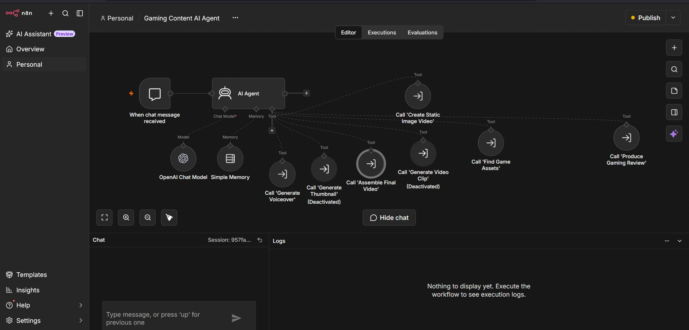
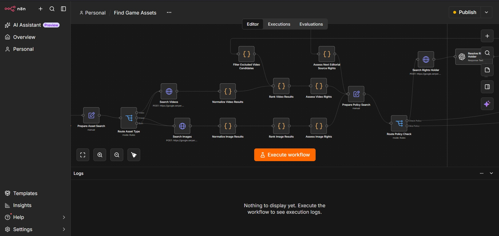
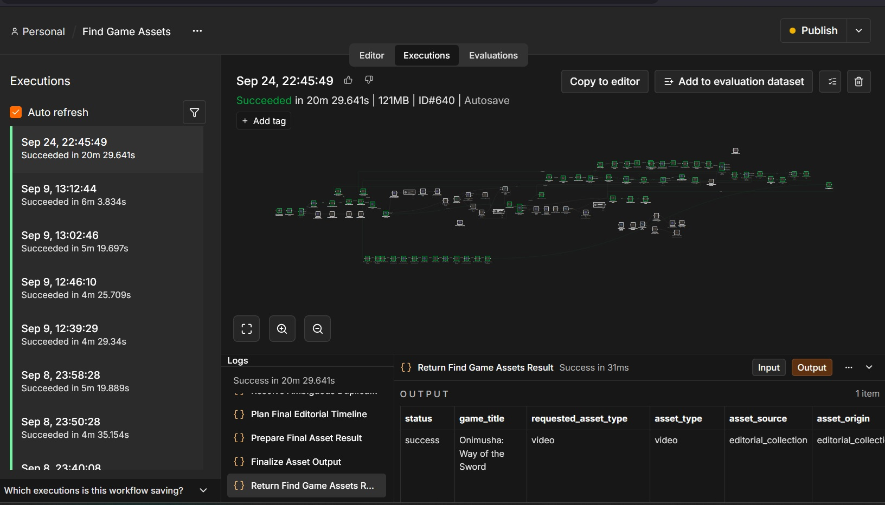
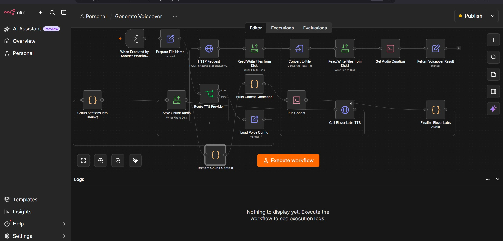
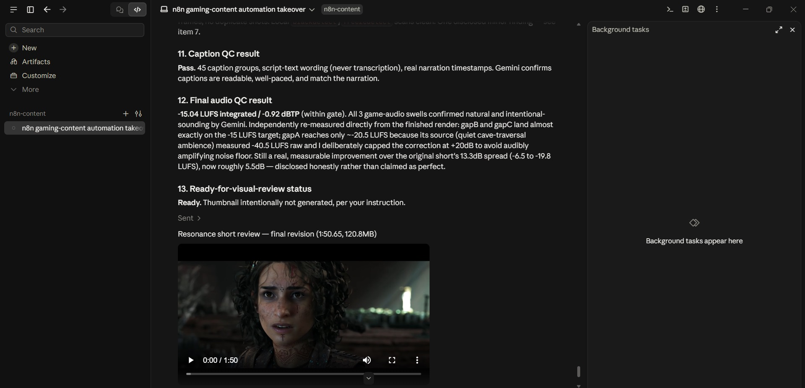

# AI Gaming Content Automation with n8n

An end-to-end AI-assisted gaming content production system built with **n8n**, combining research, asset discovery, source evaluation, voiceover generation, media processing, editorial assembly, and automated quality control.

This repository presents a sanitized portfolio version of a larger production workflow used to automate the creation of short-form and review-style gaming content.

## Project Overview

The system is designed as a modular group of connected workflows rather than a single monolithic automation.

Key capabilities include:

- AI-assisted gaming review generation
- Automated game asset discovery
- Search result normalization and ranking
- Source classification and filtering
- Rights and usage-policy checks
- Voiceover generation and multi-chunk TTS processing
- Audio concatenation and duration checks
- Media processing with FFmpeg / FFprobe
- Caption generation and timing alignment
- Editorial timeline preparation
- Automated video quality control
- Final output validation

## Main AI Agent Workflow

The main workflow acts as the orchestration layer for the production pipeline. It connects the review-generation process with asset discovery, voiceover generation, media assembly, and downstream validation steps.



The workflow is structured so that individual production tasks can be handled by dedicated sub-workflows instead of placing all logic inside one automation.

## Game Asset Discovery Pipeline

One of the largest parts of the project is the asset-discovery workflow.

Its purpose is to find relevant visual material for a game review, evaluate the available sources, rank candidate assets, and prepare selected material for later production stages.



The asset pipeline includes logic for:

- Game-title relevance validation
- Video and image search
- Search-result normalization
- Source classification
- Official/editorial source identification
- Candidate ranking
- Duplicate detection
- Previously-used source filtering
- Rights and usage-policy analysis
- Multi-source asset collection
- Clip preparation
- Temporal overlap detection
- Trimming and selection logic
- Editorial timeline preparation

The goal is not simply to return search results, but to transform raw search results into structured media candidates that can be used by later workflow stages.

## Successful Asset Workflow Execution

The asset workflow has been tested on real game-content production runs.



The example above shows a completed asset-discovery execution with structured output prepared for downstream production.

## Voiceover Generation Workflow

Narration is handled by a separate workflow so that TTS processing can be managed independently from the rest of the production pipeline.



The voiceover pipeline includes:

- Narration input processing
- Section grouping
- Chunk creation
- TTS provider routing
- ElevenLabs TTS calls
- Audio file handling
- Chunk storage
- Concatenation command generation
- Final audio assembly
- Audio-duration measurement
- Structured output returned to the main workflow

Chunk-based processing allows longer narration scripts to be handled without requiring the entire voiceover to be generated in a single API request.

## Media Processing

Custom Node.js logic and FFmpeg / FFprobe are used for media-processing tasks.

The included `render-review.cjs` script contains production logic used for tasks such as:

- Caption generation
- ASS and SRT subtitle creation
- Script-to-word alignment
- Timing calculations
- Section timing
- Editorial beat handling
- Visual keyword matching
- Media-selection scoring
- Timeline planning
- Final render preparation

## Final Output & Quality Control

The production flow contains a validation stage before a finished video is considered ready for review or publishing.



Quality-control steps include checks around the produced media, captions, audio, and final rendered output.

## Workflow Architecture

```text
User / Review Request
        |
        v
Main AI Agent
        |
        +----> Review Generation
        |
        +----> Game Asset Discovery
        |          +--> Search
        |          +--> Normalize
        |          +--> Rank
        |          +--> Rights / Policy Checks
        |          +--> Media Preparation
        |
        +----> Voiceover Generation
        |          +--> Chunking
        |          +--> TTS
        |          +--> Audio Assembly
        |
        +----> Media Processing
        |          +--> FFmpeg / FFprobe
        |          +--> Captions
        |          +--> Timeline Logic
        |
        +----> Video Quality Control
                   +--> Final Validation
```

## Tech Stack

- **n8n** — workflow orchestration
- **OpenAI** — AI-assisted research and structured processing
- **Serper** — search and asset discovery
- **ElevenLabs** — text-to-speech generation
- **Google Gemini** — media quality-control workflow
- **FFmpeg / FFprobe** — video and audio processing
- **Node.js** — custom media-processing and rendering logic
- **JSON workflow configuration** — reusable exports and examples

## Repository Structure

```text
n8n-gaming-content-automation/
├── workflows/
│   ├── gaming-review-main.json
│   ├── find-game-assets.json
│   ├── generate-voiceover.json
│   └── video-qc.json
├── scripts/
│   └── render-review.cjs
├── examples/
│   ├── review-config.json
│   └── voice-config.json
├── docs/
│   └── screenshots/
│       ├── 01-main-ai-agent-workflow.jpg
│       ├── 02-game-asset-discovery-pipeline.jpg
│       ├── 03-successful-asset-workflow-execution.jpg
│       ├── 04-voiceover-generation-workflow.jpg
│       └── 05-final-video-output-and-qc.jpg
├── .gitignore
└── README.md
```

## Included Workflows

### `gaming-review-main.json`
Main orchestration workflow for the gaming-review production process.

### `find-game-assets.json`
Asset-discovery workflow responsible for searching, evaluating, ranking, filtering, and preparing game-related visual sources.

### `generate-voiceover.json`
Dedicated narration workflow for chunk-based TTS generation and audio assembly.

### `video-qc.json`
Quality-control workflow used to evaluate generated media during final production stages.

## Security & Sanitization

This repository is a public portfolio version of a private production project.

The published workflow exports were sanitized before release.

The repository intentionally excludes:

- Real API keys
- Private credentials
- n8n runtime databases
- `.env` files
- Personal n8n project identifiers
- Local development paths
- Generated source footage
- Generated voiceovers
- Final video files
- Private Docker / n8n runtime data

Placeholders such as `YOUR_OPENAI_API_KEY`, `YOUR_SERPER_API_KEY`, `YOUR_CREDENTIAL_ID`, and `YOUR_PROJECT_ID` are used where configuration is required.

## Portfolio Scope

This repository is intended to demonstrate:

- Workflow architecture
- AI automation design
- Multi-stage n8n orchestration
- API integration
- Search and media-processing logic
- TTS workflow design
- Custom JavaScript processing
- FFmpeg-based production logic
- Quality-control automation

## Notes

This is a sanitized portfolio release rather than a complete drop-in production environment. Some external services require separate accounts, credentials, or provider-specific configuration.

## Author

**Mikelwar**

AI automation and n8n workflow development.
